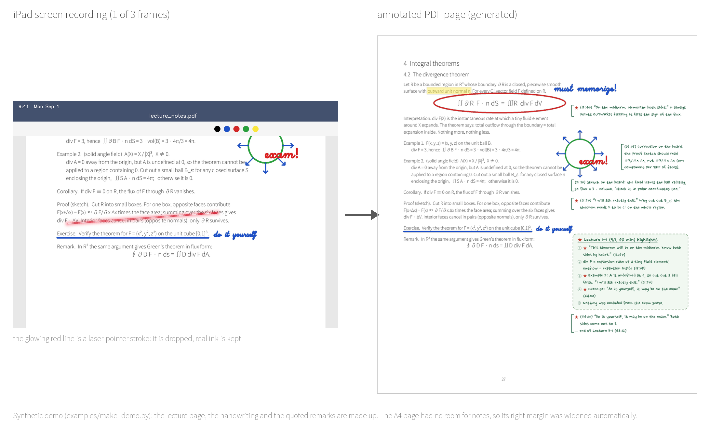

# lecture-video-notes

A [Claude Code](https://claude.com/claude-code) skill that turns lecture recordings into an annotated copy of the lecture notes.

It is built for courses where the professor teaches by writing on the lecture-note PDF on an iPad (GoodNotes and similar apps) and posts the screen recordings. You give it the recordings and the PDF. You get back:

- **the professor's handwriting on your own copy of the PDF**, in exactly the place it was written. Erased strokes and laser-pointer marks are left out.
- **every exam-relevant remark, with its timestamp**, as handwritten-style notes in the margin. Examples: "this will be on the exam", "memorize this", "do it yourself", "skip this section", corrections to the notes, and class announcements. Remarks it is unsure about are flagged.
- **a timestamped transcript** of each lecture.

When new recordings come out, it continues the same PDF, so by exam time you have one annotated document for the whole course.



*The demo above is synthetic: the page, the handwriting and the quotes are made up by [`examples/make_demo.py`](examples/make_demo.py), which runs the real pipeline. No real course material is included in this repository.*

## Why

Turning a recorded lecture into good notes usually means rewatching it. You pause to copy what was written, rewind to catch what was said, and listen for the one sentence that tells you what will be on the exam. A 50-minute recording easily costs an hour or more of attention.

This skill does that work unattended. You start it, and while it runs you can study something else, such as practice problems or another course. What you get back is better than skimming:

- **Nothing on the board is lost.** The professor's drawings, circled formulas and corrections sit on the printed page where they belong, and laser-pointer marks don't clutter it.
- **Exam hints become searchable and verifiable.** Each one carries its video timestamp, so you can jump back and hear it in context. Transcripts let you search everything that was said.
- **It scales with the semester.** Several lectures are processed in parallel, and a week's worth of recordings is ready in about an hour.

## How fast

Measured on a 2024 laptop (Intel Core Ultra 7 155H, CPU only) with real lectures of 18 to 52 minutes:

| Step | Time |
|---|---|
| Speech recognition (Whisper large-v3-turbo, int8) | about **4× faster than real time**: a 50-minute lecture takes about 12 minutes |
| Frame extraction and alignment of handwriting | about 3–5 minutes per lecture, running at the same time as speech recognition |
| Notes (Claude reads the transcript and the board) | about 5–15 minutes per lecture. Several lectures are handled in parallel |
| Building the PDF | under a minute |

End to end, without any input from you:

- one 40-minute lecture took about **25 minutes**
- seven lectures, 3 h 42 min of video in total, took about **66 minutes**

A rough rule: expect about half the video length for a single lecture, and less per lecture in batches. A machine with a supported NVIDIA GPU should transcribe much faster. That path is implemented but not benchmarked yet.

## Requirements

- Claude Code
- Windows, macOS or Linux (developed and used on Windows 11)
- [uv](https://docs.astral.sh/uv/). The setup script uses it to create a standalone Python 3.12 environment. Anaconda's Python is not used, because it crashes CTranslate2 on Windows.
- about 3 GB of disk: the speech model (1.6 GB), packages and fonts

## Install

```bash
git clone https://github.com/laufemj/lecture-video-notes ~/.claude/skills/lecture-video-notes
cd ~/.claude/skills/lecture-video-notes
bash setup.sh                                          # macOS / Linux
powershell -ExecutionPolicy Bypass -File setup.ps1     # Windows
```

The setup creates the environment in `~/.lecnotes/venv` (override with `LECNOTES_VENV`), installs the packages and downloads the fonts. If an NVIDIA GPU is present, it also installs the CUDA libraries. Then it prints an environment report.

To check the installation without any real lecture, run the synthetic demo:

```bash
~/.lecnotes/venv/bin/python examples/make_demo.py /tmp/lecnotes_demo    # Windows: %USERPROFILE%\.lecnotes\venv\Scripts\python.exe
```

## Usage

Open Claude Code in your course folder, the one with the lecture-note PDF and the recordings, and run:

```
/lecture-video-notes
```

You can also just ask, for example "make annotated notes from these lecture videos" or "continue the notes with lectures 8-1 to 9-3". Claude writes a small job file (`lecnotes_job.json`) in the course folder and then:

1. **Transcribes** the audio. It first measures this computer: GPU, CPU threads, and the actual transcription speed. If local transcription would be too slow, it tells you and suggests alternatives.
2. **Extracts the handwriting.** It keeps the frame just before each change of view, aligns it to the PDF page, and lifts out the ink. This runs at the same time as step 1.
3. **Writes the notes.** Claude reads every transcript in full, checks the board, and records each exam-relevant remark with its time.
4. **Typesets and checks.** Notes are placed around the ink and the printed text. If a page's margin is full, a memo page is inserted after it. If the PDF has no margin to speak of, the page is widened. Every page is rendered and looked at.

Videos you no longer need are only deleted when you ask, and only after you have the PDF.

## How it works

```
recordings ─┬─ transcribe.py ───────────────────────► transcripts ─► notes (Claude) ─┐
            └─ extract_views.py ─► align.py ─► rescue_align.py ─► overlay.py ─────────┴─► build.py ─► annotated PDF
```

- **Alignment:** SIFT feature matching with a scale and translation model. Hard cases get fallbacks: template matching, a higher-resolution render, and chaining through neighbouring frames for views that show only handwriting.
- **Ink extraction:** colored strokes that are not part of the printed PDF. Laser-pointer strokes are recognized by their soft glow and dropped.
- **Transcription:** faster-whisper. On Windows, audio is fed in chunks of about 10 minutes, because one long call overflows the stack.
- **Configuration:** see [`references/job_fields.md`](references/job_fields.md). Language, keywords for exam remarks, fixes for common speech-recognition mistakes, fonts, and the note column can all be set.

## Limitations

- It expects recordings of the professor **writing on the same PDF** you have. Filmed blackboards and slide-only lectures are out of scope.
- The note style, the handwriting font (Nanum Pen Script) and the default exam keywords are tuned for **Korean lectures**. Other languages work through the `language`, `keywords` and font settings, but are less polished.
- Speech recognition makes mistakes, and the notes are written by Claude. Before relying on a remark, jump to its timestamp. Unclear items are marked "※ 확인 필요" ("needs checking").

## Privacy and copyright

- Speech recognition, alignment and typesetting run **on your computer**. To write the notes, Claude reads the transcripts, frames and parts of the lecture notes, so that content is sent to Anthropic as part of your Claude Code conversation. Check your institution's rules for course materials.
- Lecture recordings, lecture notes and the annotated PDF contain your professor's work. Use them for **your own study only** and don't redistribute them.

## License

- Code: [MIT](LICENSE)
- Fonts, downloaded during setup and not included here: [Nanum Pen Script](https://fonts.google.com/specimen/Nanum+Pen+Script) and [Noto Sans KR](https://fonts.google.com/noto/specimen/Noto+Sans+KR), both under the SIL Open Font License 1.1
- Speech model: [`mobiuslabsgmbh/faster-whisper-large-v3-turbo`](https://huggingface.co/mobiuslabsgmbh/faster-whisper-large-v3-turbo), under its own license
